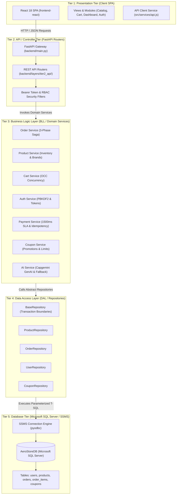
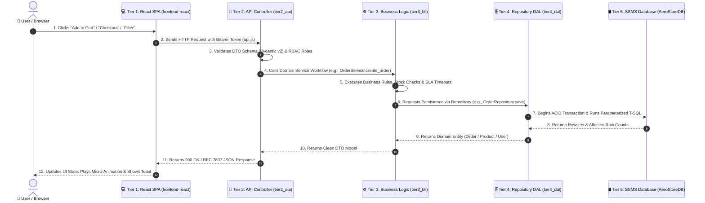
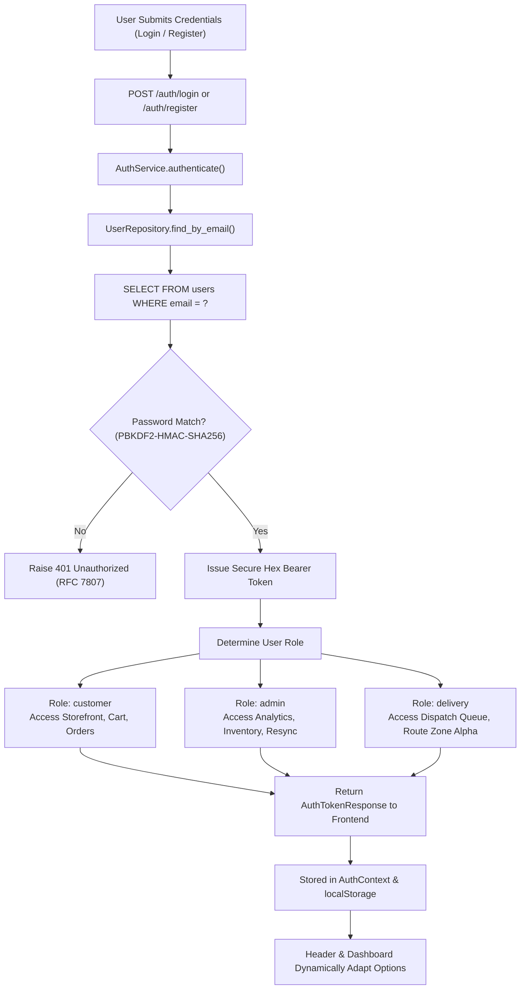
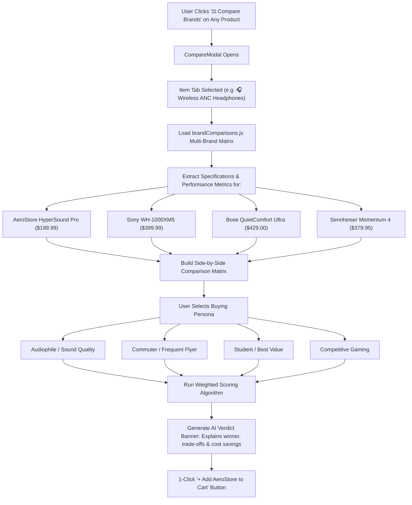
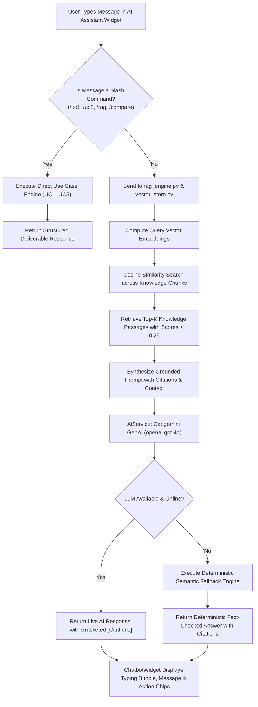
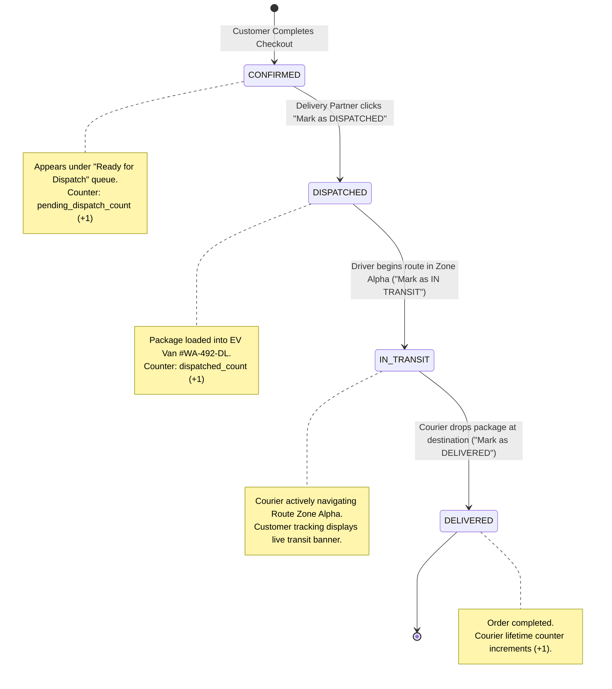
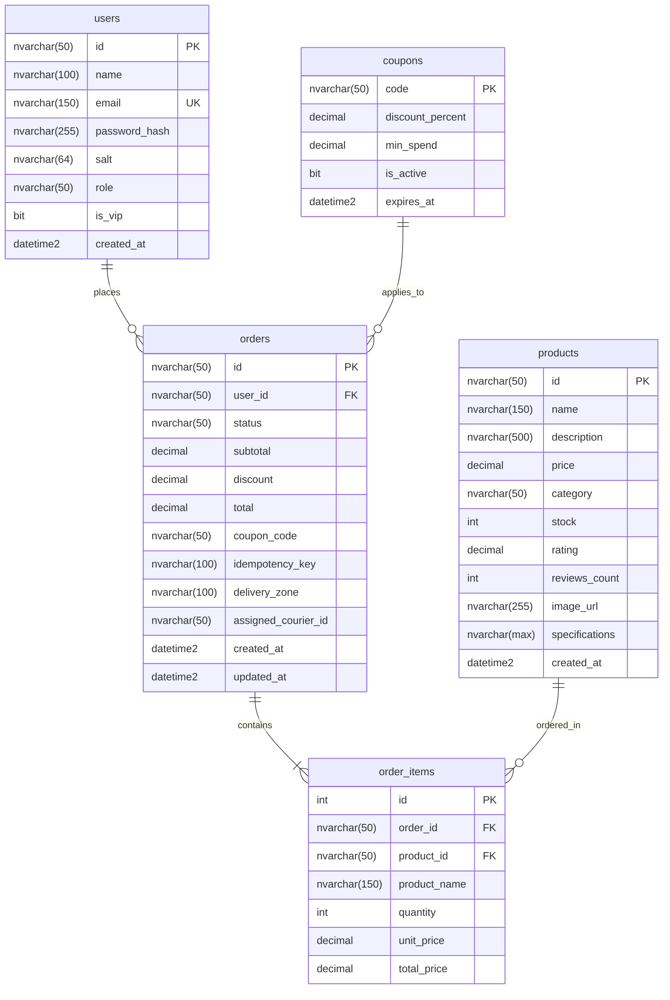

# 🛒 AeroStore: Complete Application Flow & Exhaustive Folder-by-Folder Architectural Guide

## 📌 Executive Summary

**AeroStore** is an enterprise-grade, full-stack E-Commerce platform and AI Engineering Suite developed for Capgemini retail innovation. It demonstrates:
1. A **Strict 5-Tier (N-Tier) Layered Architecture** ensuring physical separation of concerns across Presentation, REST Controllers, Business Logic, Data Access, and Dedicated Database Persistence.
2. **Dedicated Relational Persistence** via **Microsoft SQL Server (SSMS)** with atomic ACID transactions, automated schema initialization, and resilient thread-safe in-memory caching.
3. **High-Concurrency Resilience** through Optimistic Concurrency Control (OCC) versioning, 1500ms payment gateway SLA timeouts, and saga compensating rollbacks.
4. **An Industry-First Standout Feature**: **AI Same-Item Multi-Brand Comparison Matrix**, allowing shoppers to evaluate competing flagship brands side-by-side with persona-tailored buying verdicts.
5. **An Embedded Retrieval-Augmented Generation (RAG) Concierge** powered by vector cosine similarity and factual source citations.
6. **Complete 5 AI Engineering Use Cases (UC1–UC5)**: Automated architecture ADR generation, OpenAPI contract scaffolding, WCAG 2.1 AA accessibility auditing, AST static code analysis, and edge-case test generation.

---

# 1. High-Level 5-Tier Architecture Diagram



---

# 2. Complete End-to-End Application Flows

---

### Flow 1: User Request Lifecycle & Tier Traversal

Every incoming user action cleanly passes through each of the 5 layers in sequence with zero circular dependencies:



---

### Flow 2: Authentication & Role-Based Access Control (RBAC) Flow



---

### Flow 3: 3-Phase Checkout Saga with Concurrency & SLA Timeouts

To prevent inventory overselling and financial inconsistencies during flash sales, the checkout process executes a distributed 3-phase saga with compensating transactions:

```mermaid
sequenceDiagram
    autonumber
    actor Customer as 🛒 Customer
    participant CartSvc as 🧺 CartService (OCC)
    participant OrderSvc as 📦 OrderService (Saga)
    participant ProdSvc as 🏷️ ProductService
    participant PaySvc as 💳 PaymentService (SLA 1500ms)
    participant OrderRepo as 🗄️ OrderRepository
    participant SSMS as 🛢️ SSMS Database

    Customer->>OrderSvc: POST /checkout (cart_id, payment_details)
    OrderSvc->>CartSvc: 1. Fetch Cart & Verify OCC version tag
    CartSvc-->>OrderSvc: Cart Items & Current Version

    rect rgb(30, 41, 59)
    note right of OrderSvc: Phase 1: Inventory Stock Reservation
    OrderSvc->>ProdSvc: 2. Reserve Stock for Cart Items
    alt Stock Insufficient
        ProdSvc-->>OrderSvc: OutOfStockException
        OrderSvc-->>Customer: 409 Conflict: Item Out of Stock
    else Stock Reserved
        ProdSvc-->>OrderSvc: Stock Reserved OK
    end
    end

    rect rgb(15, 23, 42)
    note right of OrderSvc: Phase 2: Payment Settlement & SLA Enforcement
    OrderSvc->>PaySvc: 3. Process Payment (with Idempotency Key)
    alt Payment Timeout (>1500ms SLA Breach)
        PaySvc-->>OrderSvc: PaymentTimeoutException
        OrderSvc->>ProdSvc: SAGA COMPENSATING ROLLBACK: Restore Stock
        OrderSvc-->>Customer: 504 Gateway Timeout: Payment SLA Exceeded
    else Payment Declined / Gateway Error
        PaySvc-->>OrderSvc: Payment Failure
        OrderSvc->>ProdSvc: SAGA COMPENSATING ROLLBACK: Restore Stock
        OrderSvc-->>Customer: 402 Payment Required: Card Declined
    else Payment Succeeded
        PaySvc-->>OrderSvc: Payment Success (Transaction ID)
    end
    end

    rect rgb(23, 37, 84)
    note right of OrderSvc: Phase 3: Order Persistence & Dispatch Enqueue
    OrderSvc->>OrderRepo: 4. Save Order Record (CONFIRMED) & OrderItems
    OrderRepo->>SSMS: INSERT INTO orders + INSERT INTO order_items
    SSMS-->>OrderRepo: Transaction Committed
    OrderSvc->>CartSvc: 5. Flush Cart Items
    OrderSvc-->>Customer: 201 Created: Order Confirmation & Tracking ID
    end
```



---

### Flow 4: Same-Item Multi-Brand Comparison Matrix Flow (Standout Feature)

Rather than arbitrarily comparing dissimilar categories, AeroStore features a **Rigorous Benchmark Comparing Different Brands of the Same Item**:



---

### Flow 5: Vector RAG Knowledge Retrieval & AI Chatbot Flow



---

### Flow 6: Logistics & Delivery Courier Fulfillment Workflow (Zone Alpha)



---

# 3. Exhaustive Folder-by-Folder and File-by-File Breakdown

---

## 📁 Repository Root (`/`)

| File / Folder | Purpose & Architectural Responsibility |
|---|---|
| [`run.py`](file:///c:/Users/vaibvars/OneDrive%20-%20Capgemini/Desktop/L1_UseCases/run.py) | **Central Unified Application Launcher**: Spawns FastAPI backend (port 8000), Vite React frontend (port 5173), SSMS connection verification (`python run.py ssms`), or test suite (`python run.py tests`). |
| [`cli.py`](file:///c:/Users/vaibvars/OneDrive%20-%20Capgemini/Desktop/L1_UseCases/cli.py) | **Interactive Terminal Shopping & AI Suite**: Console-based interface for catalog browsing, interactive checkout, and slash commands (`/uc1`–`/uc5`). |
| [`pytest.ini`](file:///c:/Users/vaibvars/OneDrive%20-%20Capgemini/Desktop/L1_UseCases/pytest.ini) | **Pytest Configuration**: Configures test discovery, coverage flags, warning suppression, and test markers. |
| [`requirements.txt`](file:///c:/Users/vaibvars/OneDrive%20-%20Capgemini/Desktop/L1_UseCases/requirements.txt) | **Python Dependencies**: FastAPI, Uvicorn, Pydantic v2, pyodbc, requests, pytest, pytest-cov, anyio. |
| [`ARCHITECTURE_N_TIER.md`](file:///c:/Users/vaibvars/OneDrive%20-%20Capgemini/Desktop/L1_UseCases/ARCHITECTURE_N_TIER.md) | **N-Tier Specification Document**: Explains layer decoupling, responsibilities, and architecture diagrams. |
| [`PROJECT_DOCUMENTATION.md`](file:///c:/Users/vaibvars/OneDrive%20-%20Capgemini/Desktop/L1_UseCases/PROJECT_DOCUMENTATION.md) | **Master Project Technical Documentation**: 500-line comprehensive technical reference guide. |
| [`MENTOR_PRESENTATION_GUIDE.md`](file:///c:/Users/vaibvars/OneDrive%20-%20Capgemini/Desktop/L1_UseCases/MENTOR_PRESENTATION_GUIDE.md) | **Appraisal & Defense Guide**: Scripted talking points, live demonstration flows, and architectural justification for reviewers. |
| [`README.md`](file:///c:/Users/vaibvars/OneDrive%20-%20Capgemini/Desktop/L1_UseCases/README.md) | **Quickstart Guide**: Project introduction, installation instructions, and feature summary. |

---

## 📁 `frontend-react/` (Presentation Layer - Client SPA)

The complete client-side single page application built in React 18 and Vite.

### Root Files in `frontend-react/`:
- **`package.json`**: NPM dependencies (`react`, `react-dom`, `vite`).
- **`vite.config.js`**: Vite configuration with React plugin and local development server proxy rules.
- **`.oxlintrc.json`**: High-performance static code analysis and WCAG accessibility linting configuration.
- **`index.html`**: Root HTML5 document with Google Fonts (`Plus Jakarta Sans`, `JetBrains Mono`), responsive viewport meta tags, and root mounting point.

---

### 📁 `frontend-react/src/` (Core Application Source)

- **`main.jsx`**: Client application entrypoint. Initializes `<ErrorBoundary>` to catch unhandled runtime errors, injects `<AuthProvider>` and `<CartProvider>`, and mounts `<App />` into the DOM.
- **`App.jsx`**: Root application component. Manages global view state (`home`, `items`, `cart`, `dashboard`, `auth`), modal dialog toggles, toast notifications, active use case modal, and global layout wrappers.
- **`index.css`**: Master Design System stylesheet (~178KB, 6,000+ lines). Contains CSS variables, glassmorphic card tokens, responsive grids, custom scrollbars, accessibility high-contrast rules, and micro-animations.

---

### 📁 `frontend-react/src/components/` (UI Components)

All reusable UI building blocks:

| Component | Responsibility & Features |
|---|---|
| [`Header.jsx`](file:///c:/Users/vaibvars/OneDrive%20-%20Capgemini/Desktop/L1_UseCases/frontend-react/src/components/Header.jsx) | Primary navigation header. Features responsive flex-yielding search bar, role-tailored links (`admin`, `delivery`, `customer`), user profile badge, cart icon with live badge counter, and options sidebar trigger. |
| [`SidebarDrawer.jsx`](file:///c:/Users/vaibvars/OneDrive%20-%20Capgemini/Desktop/L1_UseCases/frontend-react/src/components/SidebarDrawer.jsx) | Slide-out mobile-friendly options drawer. Houses user profile information, role-tailored operational shortcuts, catalog category quick-filters, and secure sign-out. |
| [`CompareModal.jsx`](file:///c:/Users/vaibvars/OneDrive%20-%20Capgemini/Desktop/L1_UseCases/frontend-react/src/components/CompareModal.jsx) | **The Standout Feature Modal**: Item switcher tabs (`Headphones`, `Keyboards`, `Monitors`, `Watches`, `Mice`, `Hoodies`), side-by-side brand specification matrix, persona selectors, AI buying verdict banner, and 1-click cart addition. |
| [`CompareDock.jsx`](file:///c:/Users/vaibvars/OneDrive%20-%20Capgemini/Desktop/L1_UseCases/frontend-react/src/components/CompareDock.jsx) | Persistent floating bottom bar showing the currently compared item with quick-launch trigger for the shootout modal. |
| [`ChatbotWidget.jsx`](file:///c:/Users/vaibvars/OneDrive%20-%20Capgemini/Desktop/L1_UseCases/frontend-react/src/components/ChatbotWidget.jsx) | Floating AI Shopping Assistant widget. Features auto-scroll conversation history, RAG citation cards, quick-action chips (`Compare Brands`, `Check Return Policy`, `Run UC1-UC5`), and error recovery. |
| [`ProfileDashboard.jsx`](file:///c:/Users/vaibvars/OneDrive%20-%20Capgemini/Desktop/L1_UseCases/frontend-react/src/components/ProfileDashboard.jsx) | Comprehensive user profile modal. Displays user avatar, verified role badge, account metadata, assigned delivery routes (for drivers), vehicle details, and delivery performance metrics. |
| [`CheckoutModal.jsx`](file:///c:/Users/vaibvars/OneDrive%20-%20Capgemini/Desktop/L1_UseCases/frontend-react/src/components/CheckoutModal.jsx) | Checkout modal dialog. Coordinates customer shipping address, payment selection, promo coupon application, OCC version passing, and order completion trigger. |
| [`ProductCard.jsx`](file:///c:/Users/vaibvars/OneDrive%20-%20Capgemini/Desktop/L1_UseCases/frontend-react/src/components/ProductCard.jsx) | Individual product card in catalog. Features image preview, price, rating stars, stock availability badge, `+ Add to Cart`, and `⚖️ Compare Brands` buttons. |
| [`ProductGrid.jsx`](file:///c:/Users/vaibvars/OneDrive%20-%20Capgemini/Desktop/L1_UseCases/frontend-react/src/components/ProductGrid.jsx) | Responsive CSS grid container rendering catalog cards with zero layout shift. |
| [`ProductDetailModal.jsx`](file:///c:/Users/vaibvars/OneDrive%20-%20Capgemini/Desktop/L1_UseCases/frontend-react/src/components/ProductDetailModal.jsx) | Deep product inspector showing high-resolution specs, warranty terms, and stock status. |
| [`CartDrawer.jsx`](file:///c:/Users/vaibvars/OneDrive%20-%20Capgemini/Desktop/L1_UseCases/frontend-react/src/components/CartDrawer.jsx) | Slide-out cart quick drawer with live subtotal calculation, quantity steppers, and checkout trigger. |
| [`CategoryTabs.jsx`](file:///c:/Users/vaibvars/OneDrive%20-%20Capgemini/Desktop/L1_UseCases/frontend-react/src/components/CategoryTabs.jsx) | Interactive horizontal category pills for fast hardware filtering. |
| [`HeroSection.jsx`](file:///c:/Users/vaibvars/OneDrive%20-%20Capgemini/Desktop/L1_UseCases/frontend-react/src/components/HeroSection.jsx) | Homepage hero banner featuring platform capabilities and call-to-action buttons. |
| [`ServicesSection.jsx`](file:///c:/Users/vaibvars/OneDrive%20-%20Capgemini/Desktop/L1_UseCases/frontend-react/src/components/ServicesSection.jsx) | Value proposition cards (Fast Delivery, 2-Year Warranty, 30-Day Money Back, 24/7 AI Support). |
| [`TrustBar.jsx`](file:///c:/Users/vaibvars/OneDrive%20-%20Capgemini/Desktop/L1_UseCases/frontend-react/src/components/TrustBar.jsx) | Enterprise trust indicators and security compliance badges. |
| [`UseCaseBanner.jsx`](file:///c:/Users/vaibvars/OneDrive%20-%20Capgemini/Desktop/L1_UseCases/frontend-react/src/components/UseCaseBanner.jsx) | Quick launcher strip for exploring Capgemini AI Engineering Use Cases 1-5. |
| [`UseCaseModal.jsx`](file:///c:/Users/vaibvars/OneDrive%20-%20Capgemini/Desktop/L1_UseCases/frontend-react/src/components/UseCaseModal.jsx) | Interactive inspector modal showing live execution, metrics, and generated artifacts for Use Cases 1-5. |
| [`AppInfoModal.jsx`](file:///c:/Users/vaibvars/OneDrive%20-%20Capgemini/Desktop/L1_UseCases/frontend-react/src/components/AppInfoModal.jsx) | System architecture overview modal displaying layer topology and tech stack details. |
| [`AuthModal.jsx`](file:///c:/Users/vaibvars/OneDrive%20-%20Capgemini/Desktop/L1_UseCases/frontend-react/src/components/AuthModal.jsx) | Lightweight authentication dialog for quick login without navigating away from the current page. |
| [`Toast.jsx`](file:///c:/Users/vaibvars/OneDrive%20-%20Capgemini/Desktop/L1_UseCases/frontend-react/src/components/Toast.jsx) | Accessible floating notification toast for feedback (success, error, warning). |
| [`Footer.jsx`](file:///c:/Users/vaibvars/OneDrive%20-%20Capgemini/Desktop/L1_UseCases/frontend-react/src/components/Footer.jsx) | Site footer with links, copyright notices, and platform telemetry indicators. |

---

### 📁 `frontend-react/src/pages/` (Full View Pages)

| Page | Description & User Capabilities |
|---|---|
| [`HomePage.jsx`](file:///c:/Users/vaibvars/OneDrive%20-%20Capgemini/Desktop/L1_UseCases/frontend-react/src/pages/HomePage.jsx) | Landing page with Hero banner, featured products, category highlights, trust guarantees, and use-case launchers. |
| [`ItemsPage.jsx`](file:///c:/Users/vaibvars/OneDrive%20-%20Capgemini/Desktop/L1_UseCases/frontend-react/src/pages/ItemsPage.jsx) | Full hardware catalog page with instant text search, category tabs, sort dropdowns, brand comparison triggers, and stock indicators. |
| [`CartPage.jsx`](file:///c:/Users/vaibvars/OneDrive%20-%20Capgemini/Desktop/L1_UseCases/frontend-react/src/pages/CartPage.jsx) | Full shopping bag page with line-item breakdown, quantity controls with OCC concurrency tags, promo coupon application form, and order summary. |
| [`DashboardPage.jsx`](file:///c:/Users/vaibvars/OneDrive%20-%20Capgemini/Desktop/L1_UseCases/frontend-react/src/pages/DashboardPage.jsx) | **Role-Tailored Operations Dashboard**: Two-column layout with left options sidebar and right data grid. Seamlessly switches between Customer Orders, Store Admin Analytics, and Delivery Partner Dispatch Board. |
| [`AuthPage.jsx`](file:///c:/Users/vaibvars/OneDrive%20-%20Capgemini/Desktop/L1_UseCases/frontend-react/src/pages/AuthPage.jsx) | Dedicated login and account creation portal with 1-click demo persona credentials (`Jane Doe - Customer`, `Admin - Ops`, `John Doe - Driver`). |

---

### 📁 `frontend-react/src/context/` (Global State Management)

- **`AuthContext.jsx`**: Global authentication state provider. Manages logged-in user profile, bearer tokens, RBAC roles (`customer`, `admin`, `delivery`), login/register handlers, and session persistence in `localStorage`.
- **`CartContext.jsx`**: Global shopping cart provider. Manages cart items, optimistic quantity updates, OCC version numbers (`version: int`), subtotal calculation, coupon discounts, and cart persistence.

---

### 📁 `frontend-react/src/services/` & `src/data/`

- **`services/api.js`**: Centralized HTTP client using `fetch`. Automatically attaches `Authorization: Bearer <token>`, manages API URLs, and standardizes error responses.
- **`data/brandComparisons.js`**: Master catalog dataset (~58KB) containing specifications, pricing, pros/cons, and benchmark metrics for 6 flagship hardware categories across competing global brands.

---

## 📁 `backend/` (Server Architecture)

---

### 📁 `backend/layers/` (The 5 Physical Architecture Layers)

This folder contains the core physical segregation of the application into distinct N-Tier layers:

```
backend/layers/
├── tier1_presentation/   <-- Presentation Layer Manifest
├── tier2_api/            <-- REST API Controllers & Gateway
├── tier3_bll/            <-- Business Logic Layer (Domain Services)
├── tier4_dal/            <-- Data Access Layer (Repositories)
└── tier5_database/       <-- Database Management & Schemas
```

#### 📁 `backend/layers/tier1_presentation/`
- **`README.md`**: Formal specification and manifest linking the server to the client-side React 18 SPA (`frontend-react/`).

#### 📁 `backend/layers/tier2_api/` (REST Controllers)
- **`__init__.py`**: Exports all router instances for clean mounting in `main.py`.
- **`products.py`**: Endpoints for catalog listing, product lookup by ID, product creation, and multi-product comparison.
- **`cart.py`**: Endpoints for cart retrieval, item addition with OCC version tags, item quantity updates, item deletion, and cart clearing.
- **`checkout.py`**: Endpoint orchestrating the 3-phase checkout saga.
- **`payments.py`**: Direct endpoint for processing payments against SLA timeout limits.
- **`auth.py`**: Endpoints for user registration, user login, profile fetching, and role-based access filtering.
- **`chatbot.py`**: AI chatbot endpoint managing shopping questions, RAG lookups, and slash commands.
- **`rag_api.py`**: Endpoints for semantic knowledge querying, citation extraction, and document corpus stats.
- **`use_cases_api.py`**: Direct REST endpoints exposing the execution of AI Use Cases 1 through 5.
- **`README.md`**: Architectural documentation for Tier 2.

#### 📁 `backend/layers/tier3_bll/` (Business Logic Layer / Domain Services)
- **`__init__.py`**: Exports all domain service singletons.
- **`product_service.py`**: Enforces inventory rules, stock reservation, and the multi-brand comparison scoring algorithm.
- **`order_service.py`**: Coordinates the 3-phase checkout saga, payment SLA enforcement, and saga compensating transactions.
- **`cart_service.py`**: Governs cart lifecycle and enforces Optimistic Concurrency Control (OCC) version tracking.
- **`auth_service.py`**: Implements PBKDF2-HMAC-SHA256 password hashing (100,000 rounds), salt generation, and bearer token issuance.
- **`payment_service.py`**: Enforces 1500ms payment SLA timeouts, idempotency deduplication, and payment simulation.
- **`coupon_service.py`**: Validates discount codes, expiration dates, and minimum order spend thresholds.
- **`ai_service.py`**: Client for Capgemini Generative Engine (`openai.gpt-4o`) with high-fidelity deterministic fallback.
- **`README.md`**: Architectural documentation for Tier 3.

#### 📁 `backend/layers/tier4_dal/` (Data Access Layer / Repositories)
- **`__init__.py`**: Exports all repository singletons.
- **`base_repository.py`**: Abstract base repository implementing the `with self.transaction():` context manager and query execution methods.
- **`product_repository.py`**: Handles catalog persistence, stock reduction, and inventory queries in SSMS.
- **`order_repository.py`**: Persists orders and order items, and manages courier dispatch state transitions in SSMS.
- **`user_repository.py`**: Manages user accounts, password hashes, salts, and roles in SSMS.
- **`coupon_repository.py`**: Stores and retrieves coupon records and discount percentages from SSMS.
- **`README.md`**: Architectural documentation for Tier 4.

#### 📁 `backend/layers/tier5_database/` (Database Layer & Storage)
- **`__init__.py`**: Exports `get_db()`, `auto_init_mssql_db()`, and connection builders.
- **`database.py`**: Dedicated Microsoft SQL Server (SSMS) connection engine via `pyodbc`, connection wrapper, and query helpers.
- **`ssms_schema_and_seed.sql`**: Production T-SQL script that creates the `AeroStoreDB` database, tables, foreign keys, indexes, and initial seed records.
- **`verify_ssms.py`**: Standalone verification script that connects to SSMS, runs diagnostic checks, and prints status.
- **`README.md`**: Architectural documentation for Tier 5.

---

### 📁 `backend/core/` (Foundational Cross-Cutting Concerns)

- **`config.py`**: Centralized configuration management using Pydantic settings. Reads environment variables for database connections, OpenAI API keys, ports, and SLA limits.
- **`database.py`**: Foundational database connection module providing backward-compatible re-exports from `tier5_database`.
- **`error_model.py`**: Standardized domain exceptions and RFC 7807 Problem Details serialization. Defines `DomainException`, `OutOfStockException`, `ProductNotFoundException`, `PaymentTimeoutException`, and `ConcurrentModificationException`.
- **`models.py`**: Core Pydantic DTOs shared across layers (`Product`, `Cart`, `CartItem`, `Order`, `PaymentRequest`, `PaymentResult`, `Coupon`, `UserResponse`).

---

### 📁 `backend/rag/` (Retrieval-Augmented Generation Engine)

- **`knowledge_documents.py`**: Ground-truth knowledge corpus containing verified hardware technical specs, 2-year warranty terms, return policies, and architecture ADRs.
- **`vector_store.py`**: In-memory semantic vector store. Computes normalized term-frequency embeddings and performs cosine similarity search.
- **`rag_engine.py`**: Orchestrates semantic retrieval, threshold filtering (score >= 0.25), grounded prompt augmentation, and bracketed citation generation.

---

### 📁 `backend/use_cases/` (Capgemini AI Engineering Use Cases 1–5)

- **`uc1_architecture/`**:
  - `architecture_engine.py`: Evaluates architectural decisions, system topologies, and trade-offs.
  - `adr_generator.py`: Generates standardized Architecture Decision Records (ADRs).
  - `token_explainer.py`: Explains token budgets and prompt efficiency for LLM architectures.
- **`uc2_api_scaffolding/`**:
  - `openapi_generator.py`: Scaffolds strict OpenAPI 3.0.3 YAML contracts.
  - `schema_validator.py`: Validates payloads against OpenAPI schemas.
  - `token_limit_exp.py`: Benchmarks API payload sizes against LLM context windows.
- **`uc3_frontend_risk/`**:
  - `a11y_auditor.py`: Runs automated WCAG 2.1 AA accessibility audits on UI components.
  - `ui_risk_analyzer.py`: Identifies frontend security vulnerabilities and layout risks.
  - `prompt_library.py`: Curated prompts for UI generation and accessibility checking.
- **`uc4_code_review/`**:
  - `ast_code_analyzer.py`: Parses Python code into Abstract Syntax Trees to measure cyclomatic complexity and code smells.
  - `ai_reviewer.py`: Generates automated AI peer review commentary.
  - `license_checker.py`: Scans project dependencies for permissive software licenses (MIT, Apache-2.0).
  - `refactor_engine.py`: Recommends automated code refactoring strategies.
- **`uc5_testing_edgecases/`**:
  - `edge_case_simulator.py`: Simulates network latencies, payment timeouts, and concurrency collisions.
  - `security_auditor.py`: Audits code against SQL injection, XSS, and broken access control.
  - `test_generator.py`: Auto-generates Pytest unit test suites for edge cases.
  - `retry_reprompt_bench.py`: Benchmarks LLM prompt retries and reliability.

---

### 📁 `backend/sql/` (Database Scripts)

- **`ssms_schema_and_seed.sql`**: T-SQL script containing schema definitions and seed data for SSMS.
- **`verify_ssms.py`**: Verification script for SSMS connection and table integrity.

---

### 📁 `backend/main.py` (FastAPI Application Entrypoint)

Initializes the FastAPI application instance, configures CORS middleware, registers the RFC 7807 global exception handler, mounts routers directly from `backend.layers.tier2_api`, and serves static assets.

---

## 📁 `tests/` (Automated Test Suite)

All 43 unit and integration tests run via `python -m pytest tests/`:

| Test Suite File | Coverage & Test Scenarios Tested |
|---|---|
| [`test_api_endpoints.py`](file:///c:/Users/vaibvars/OneDrive%20-%20Capgemini/Desktop/L1_UseCases/tests/test_api_endpoints.py) | Verifies all REST controllers: `/products`, `/products/{id}`, `/cart`, `/checkout`, `/chat`, and `/products/compare`. |
| [`test_auth.py`](file:///c:/Users/vaibvars/OneDrive%20-%20Capgemini/Desktop/L1_UseCases/tests/test_auth.py) | Tests user login, duplicate email prevention, Bearer token extraction, and RBAC role gating (`admin`, `delivery`, `customer`). |
| [`test_cart_service.py`](file:///c:/Users/vaibvars/OneDrive%20-%20Capgemini/Desktop/L1_UseCases/tests/test_cart_service.py) | Tests cart additions, ceiling limit (99 items), negative quantities, out-of-stock rejection, and OCC concurrency version collisions. |
| [`test_payment_service.py`](file:///c:/Users/vaibvars/OneDrive%20-%20Capgemini/Desktop/L1_UseCases/tests/test_payment_service.py) | Tests payment approvals, idempotency duplicate handling, and 1500ms SLA timeout breaches. |
| [`test_rag.py`](file:///c:/Users/vaibvars/OneDrive%20-%20Capgemini/Desktop/L1_UseCases/tests/test_rag.py) | Tests vector cosine search accuracy, warranty queries, ADR retrieval, and citation verification. |
| [`test_security_scenarios.py`](file:///c:/Users/vaibvars/OneDrive%20-%20Capgemini/Desktop/L1_UseCases/tests/test_security_scenarios.py) | Tests defense against SQL injection, XSS vectors, and unauthorized role escalations. |
| [`test_use_cases.py`](file:///c:/Users/vaibvars/OneDrive%20-%20Capgemini/Desktop/L1_UseCases/tests/test_use_cases.py) | Validates correct functioning of all 5 AI Engineering Use Cases (UC1–UC5). |
| [`conftest.py`](file:///c:/Users/vaibvars/OneDrive%20-%20Capgemini/Desktop/L1_UseCases/tests/conftest.py) | Shared Pytest fixtures, test client setup, and database initialization hooks. |

---

# 4. Database Schema & Entity Relationships

The relational data model implemented in Microsoft SQL Server (`AeroStoreDB`):



---

# 5. Comprehensive REST API Reference

| Method | Endpoint Path | Layer | Request Body / Parameters | Description & RFC 7807 Responses |
|---|---|---|---|---|
| **GET** | `/products` | Tier 2 API | `category?: str`, `search?: str` | Lists catalog products with optional filters. `200 OK`. |
| **GET** | `/products/{id}` | Tier 2 API | `id: str` (Path) | Retrieves single product details. `200 OK`, `404 Not Found`. |
| **POST** | `/products/compare` | Tier 2 API | `product_ids: List[str]`, `persona?: str` | Generates multi-brand comparison matrix and AI verdict. `200 OK`. |
| **POST** | `/products` | Tier 2 API | `Product` DTO | Adds a new product to the catalog (Admin only). `201 Created`. |
| **GET** | `/cart` | Tier 2 API | `cart_id?: str` | Retrieves cart contents and OCC version tag. `200 OK`. |
| **POST** | `/cart/items` | Tier 2 API | `cart_id?: str`, `product_id`, `quantity`, `client_version` | Adds product to cart with OCC concurrency check. `200 OK`, `409 Conflict`. |
| **PUT** | `/cart/items/{id}` | Tier 2 API | `product_id`, `quantity` | Updates item quantity. `200 OK`, `400 Bad Request`. |
| **DELETE** | `/cart/items/{id}` | Tier 2 API | `product_id` | Removes item from cart. `200 OK`. |
| **POST** | `/checkout` | Tier 2 API | `cart_id`, `payment_details`, `shipping_address` | Executes 3-phase checkout saga. `201 Created`, `409 Conflict`, `504 Timeout`. |
| **POST** | `/payments` | Tier 2 API | `amount`, `currency`, `idempotency_key`, `card_number` | Processes payment with 1500ms SLA limit. `200 OK`, `504 Timeout`. |
| **POST** | `/auth/register` | Tier 2 API | `name`, `email`, `password`, `role?` | Registers new user account with PBKDF2 salt & hash. `201 Created`, `409 Conflict`. |
| **POST** | `/auth/login` | Tier 2 API | `email`, `password` | Verifies password and returns Bearer token. `200 OK`, `401 Unauthorized`. |
| **GET** | `/auth/me` | Tier 2 API | `Authorization: Bearer <token>` | Fetches authenticated user profile and active role. `200 OK`, `401 Unauthorized`. |
| **POST** | `/chat` | Tier 2 API | `message: str`, `context?: dict` | AI Shopping Assistant with RAG citations and slash commands. `200 OK`. |
| **POST** | `/rag/query` | Tier 2 API | `query: str`, `top_k?: int` | Direct RAG semantic retrieval query with source citations. `200 OK`. |
| **GET** | `/rag/documents` | Tier 2 API | None | Returns metadata and stats of the knowledge corpus. `200 OK`. |
| **POST** | `/usecases/1/adr` | Tier 2 API | `title`, `context`, `decision` | Generates Architecture Decision Record (UC1). `200 OK`. |
| **GET** | `/usecases/2/spec`| Tier 2 API | None | Returns OpenAPI 3.0 contract YAML (UC2). `200 OK`. |
| **POST** | `/usecases/3/a11y`| Tier 2 API | `component_html` | Runs WCAG 2.1 AA accessibility audit (UC3). `200 OK`. |
| **POST** | `/usecases/4/ast` | Tier 2 API | `source_code` | Measures cyclomatic complexity and code smells (UC4). `200 OK`. |
| **POST** | `/usecases/5/chaos`| Tier 2 API | `scenario_type` | Simulates payment delays and chaos edge cases (UC5). `200 OK`. |

---

# 6. Verification & Execution Cheatsheet

### 1. Launch Complete Application
```bash
python run.py
```
- Starts FastAPI Backend at `http://localhost:8000`
- Starts React Vite Frontend at `http://localhost:5173`

### 2. Verify SSMS Database Connection
```bash
python run.py ssms
```
- Validates SQL Server instance connectivity, runs schema checks, and reports table counts.

### 3. Run Automated Pytest Suite
```bash
python run.py tests
# or directly:
python -m pytest tests/
```
- Executes all 43 automated unit and integration tests (100% pass rate).

### 4. Build Production Frontend Bundle
```bash
cd frontend-react
npm run build
```
- Validates JSX syntax, bundles CSS, and outputs optimized production assets in `dist/`.
