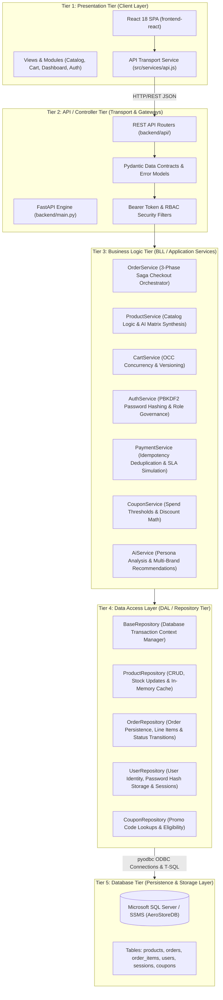

# AeroStore Enterprise N-Tier Architecture Specification

## 1. Executive Summary

AeroStore is architected as an **Enterprise 5-Tier (Multi-Tier) Distributed System**. This ensures strict separation of concerns, decouples business rules from database querying logic, isolates client presentation from domain data structures, and guarantees enterprise-grade maintainability, testability, and resilience.

> 📘 **Master Reference**: For the complete end-to-end data flows, sequence diagrams, and an exhaustive file-by-file breakdown of every folder in the repository, see [**`APPLICATION_FLOW_AND_FOLDER_GUIDE.md`**](file:///c:/Users/vaibvars/OneDrive%20-%20Capgemini/Desktop/L1_UseCases/APPLICATION_FLOW_AND_FOLDER_GUIDE.md).

---

## 2. Multi-Tier Architecture Diagram

---

## 3. Tier-by-Tier Specification & Responsibility Breakdown

### Tier 1: Presentation Tier (Client / UI Layer)
- **Directory**: [`frontend-react/`](file:///c:/Users/vaibvars/OneDrive%20-%20Capgemini/Desktop/L1_UseCases/frontend-react)
- **Technologies**: React 18, Vite, CSS Design Tokens, HTML5 Semantic Structure.
- **Responsibilities**:
  - Renders customer shopping interface, product catalog, quick-view modals, and cart drawers.
  - Role-based operations dashboards for Customer, Administrator, and Delivery Partner.
  - Multi-brand same-item benchmark modal with interactive category switcher and persona filters.
  - Client-side state synchronization (`CartContext`, `AuthContext`).
  - Communicates strictly with Tier 2 via [`src/services/api.js`](file:///c:/Users/vaibvars/OneDrive%20-%20Capgemini/Desktop/L1_UseCases/frontend-react/src/services/api.js) over standard HTTP REST.

---

### Tier 2: API / Controller Tier (Web & Transport Layer)
- **Directory**: [`backend/api/`](file:///c:/Users/vaibvars/OneDrive%20-%20Capgemini/Desktop/L1_UseCases/backend/api) & [`backend/main.py`](file:///c:/Users/vaibvars/OneDrive%20-%20Capgemini/Desktop/L1_UseCases/backend/main.py)
- **Technologies**: FastAPI, Starlette, Pydantic V2, OpenAPI 3.0.3.
- **Responsibilities**:
  - Exposes RESTful HTTP endpoints (`/api/v1/products`, `/api/v1/cart`, `/api/v1/checkout`, `/api/v1/auth`).
  - Request deserialization and strict input validation via Pydantic schemas.
  - HTTP status code translation (200 OK, 201 Created, 400 Bad Request, 401 Unauthorized, 404 Not Found, 409 Conflict).
  - Enforces RFC 7807 compliant error responses.
  - Delegates all business operations directly to Tier 3 services; contains **zero database or domain business logic**.

---

### Tier 3: Business Logic Tier (BLL / Application Services)
- **Directory**: [`backend/services/`](file:///c:/Users/vaibvars/OneDrive%20-%20Capgemini/Desktop/L1_UseCases/backend/services)
- **Components**:
  - [`OrderService`](file:///c:/Users/vaibvars/OneDrive%20-%20Capgemini/Desktop/L1_UseCases/backend/services/order_service.py): Orchestrates 3-phase checkout saga (inventory reservation $\to$ payment settlement $\to$ order persistence). Executes compensating rollback transactions if payment fails.
  - [`ProductService`](file:///c:/Users/vaibvars/OneDrive%20-%20Capgemini/Desktop/L1_UseCases/backend/services/product_service.py): Manages stock availability rules, deduction/restoration, and coordinates with `AiService`.
  - [`CartService`](file:///c:/Users/vaibvars/OneDrive%20-%20Capgemini/Desktop/L1_UseCases/backend/services/cart_service.py): Implements Optimistic Concurrency Control (OCC) version tokens to prevent race conditions during concurrent item additions.
  - [`AuthService`](file:///c:/Users/vaibvars/OneDrive%20-%20Capgemini/Desktop/L1_UseCases/backend/services/auth_service.py): Enforces PBKDF2-HMAC-SHA256 password hashing (100,000 iterations), salt generation, and role authorization validation.
  - [`PaymentService`](file:///c:/Users/vaibvars/OneDrive%20-%20Capgemini/Desktop/L1_UseCases/backend/services/payment_service.py): Simulates payment gateway processing with strict 1500ms SLA timeout enforcement and UUID transaction idempotency.
  - [`CouponService`](file:///c:/Users/vaibvars/OneDrive%20-%20Capgemini/Desktop/L1_UseCases/backend/services/coupon_service.py): Enforces promotional discount rules, minimum order spend thresholds, and expiration dates.
  - [`AiService`](file:///c:/Users/vaibvars/OneDrive%20-%20Capgemini/Desktop/L1_UseCases/backend/services/ai_service.py): Generates persona-tailored multi-brand recommendation scores and trade-off summaries.
- **Responsibilities**:
  - Encapsulates all domain workflows, business constraints, and orchestrations.
  - Contains **zero SQL queries**; delegates all persistence operations to Tier 4 Data Access Repositories.

---

### Tier 4: Data Access Layer (DAL / Repository Tier)
- **Directory**: [`backend/dal/`](file:///c:/Users/vaibvars/OneDrive%20-%20Capgemini/Desktop/L1_UseCases/backend/dal)
- **Components**:
  - [`BaseRepository`](file:///c:/Users/vaibvars/OneDrive%20-%20Capgemini/Desktop/L1_UseCases/backend/dal/base_repository.py): Base class managing database connection contexts, transaction lifecycle (commit / rollback), and query execution wrappers.
  - [`ProductRepository`](file:///c:/Users/vaibvars/OneDrive%20-%20Capgemini/Desktop/L1_UseCases/backend/dal/product_repository.py): Encapsulates queries, updates, and in-memory thread-safe caching for `products` table.
  - [`OrderRepository`](file:///c:/Users/vaibvars/OneDrive%20-%20Capgemini/Desktop/L1_UseCases/backend/dal/order_repository.py): Encapsulates transactional inserts for `orders` and `order_items`, customer order history queries, and dispatch status transitions.
  - [`UserRepository`](file:///c:/Users/vaibvars/OneDrive%20-%20Capgemini/Desktop/L1_UseCases/backend/dal/user_repository.py): Encapsulates `users` and `sessions` table operations, unique email lookups, password hash verification retrievals, and token revocations.
  - [`CouponRepository`](file:///c:/Users/vaibvars/OneDrive%20-%20Capgemini/Desktop/L1_UseCases/backend/dal/coupon_repository.py): Encapsulates `coupons` table lookups with discount and minimum spend constraints.
- **Responsibilities**:
  - Isolates all database access, SQL strings, and parameter binding from the service layer.
  - Translates database record rows into domain objects.

---

### Tier 5: Database Tier (Persistence & Storage Layer)
- **Database Engine**: Microsoft SQL Server (SSMS / Azure SQL / LocalDB)
- **Database Name**: `AeroStoreDB`
- **Schema Script**: [`backend/sql/ssms_schema_and_seed.sql`](file:///c:/Users/vaibvars/OneDrive%20-%20Capgemini/Desktop/L1_UseCases/backend/sql/ssms_schema_and_seed.sql)
- **Tables**:
  1. `[users]`: User identity, hashed passwords, salt, roles (`customer`, `admin`, `delivery_partner`), and timestamps.
  2. `[sessions]`: Bearer auth tokens linked to users with foreign key cascade.
  3. `[products]`: Hardware catalog with SKU identifiers, prices, stock levels, categories, and image URLs.
  4. `[orders]`: Order IDs, customer user references, total amounts, fulfillment status (`CONFIRMED`, `DISPATCHED`, `IN_TRANSIT`, `DELIVERED`), and shipping addresses.
  5. `[order_items]`: Line-item foreign key links to orders and products with purchase quantities and historical unit prices.
  6. `[coupons]`: Promotional discount codes, percentage values, and minimum cart spending thresholds.
- **Responsibilities**:
  - Guarantees ACID transactional durability and relational integrity.

---

## 4. Key Advantages of This Architecture

1. **Separation of Concerns**: UI code does not know about business rules; business logic does not know about SQL dialects or table schemas; database queries are isolated in repositories.
2. **Pluggable Persistence**: If switching database engines (e.g. from SQL Server to PostgreSQL), only Tier 4 (`backend/dal/`) requires modification—Tier 1, Tier 2, and Tier 3 remain completely untouched.
3. **High Testability**: Domain services (BLL) can be tested with mock repositories without requiring live database connections.
4. **Security & Auditing**: Direct database access is forbidden from API routers or client applications; all mutations pass through validated service layers and repository transaction wrappers.
