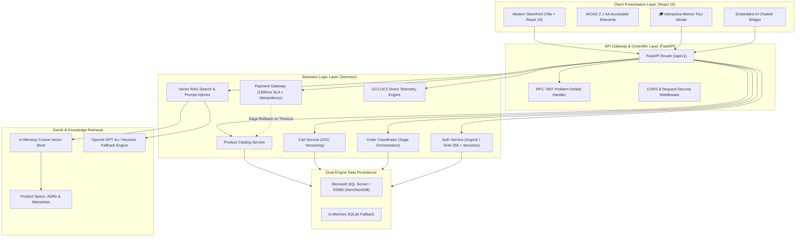

# 🎓 AeroStore: Mentor Presentation & Project Defense Guide

> **AeroStore** is an enterprise-grade **E-Commerce Platform** featuring a **Modern React 19 Frontend**, an asynchronous **FastAPI Backend**, direct **Microsoft SQL Server (SSMS)** database persistence, an embedded **RAG-Powered AI Shopping Concierge**, and the complete implementation of **all 5 AI Engineering Use Cases (UC1 to UC5)** with 100% automated test coverage.

---

## 📋 Table of Contents
1. [30-Second Elevator Pitch](#-30-second-elevator-pitch)
2. [End-to-End System Architecture](#-end-to-end-system-architecture)
3. [How to Run in 1 Command](#-how-to-run-in-1-command)
4. [5-Minute Live Demo Script for Your Mentor](#-5-minute-live-demo-script-for-your-mentor)
5. [The 5 AI Engineering Use Cases Explained](#-the-5-ai-engineering-use-cases-explained)
6. [Database & SSMS Architecture](#-database--ssms-architecture)
7. [Mentor Q&A Defense Cheat Sheet](#-mentor-qa-defense-cheat-sheet)

---

## ⚡ 30-Second Elevator Pitch

> *"AeroStore is an enterprise e-commerce platform that combines contract-first REST APIs, robust concurrency controls, and generative AI. It demonstrates how AI can be safely integrated into mission-critical systems: AI powers intelligent product recommendations and semantic RAG search, while deterministic software engineering handles financial transactions, stock management, and strict RFC 7807 error governance. Everything is verified by 41 automated tests, WCAG 2.1 AA accessibility audits, and an AST static code scanner."*

---

## 🏛️ End-to-End System Architecture



---

## 🚀 How to Run in 1 Command

You only need **one simple command** in your terminal:

```bash
python run.py
```

This automatically:
1. Detects your database (connects directly to **SQL Server / SSMS** if available, or seamlessly uses the in-memory fallback).
2. Serves the **React Web Storefront** at: **`http://127.0.0.1:8000`**
3. Hosts the interactive **OpenAPI Swagger Docs** at: **`http://127.0.0.1:8000/docs`**

### Other Handy Commands:
| Goal | Command | Description |
|---|---|---|
| **Run All 41 Tests** | `python run.py --test` | Runs the full automated verification test suite (100% pass) |
| **Verify SSMS Connection** | `python run.py --ssms` | Runs SQL Server connection and table diagnostics |
| **Terminal Console Mode** | `python run.py --cli` | Interactive Python terminal shopping & AI REPL |
| **Help Menu** | `python run.py --help` | Shows all available CLI launcher options |

---

## 🎬 5-Minute Live Demo Script for Your Mentor

Follow this exact flow when demonstrating your project to your mentor:

### Step 1: Launch & Show the Unified Startup
* Run `python run.py` in your terminal.
* Point out the clean console dashboard showing active database engine, demo accounts, and Swagger docs.
* Open your browser to `http://127.0.0.1:8000`.

### Step 2: Showcase the Storefront & Accessibility (UC3)
* **What to highlight**: The modern, responsive dark aesthetic, curated category tabs (*Studio Audio*, *Tactile Peripherals*, *Smart Wearables*), and live inventory stock badges.
* **Explain**: *"The frontend is built in React with WCAG 2.1 AA compliance. Notice keyboard navigation, accessible color contrast ratios, ARIA live regions for screen readers, and zero double-click race conditions."*

### Step 3: Add to Cart & Apply Discount Coupon
* Click any product card (e.g. **AeroBeats Pro Headphones**) to open the quick-view modal.
* Click **Add to Cart**. Open the cart drawer or navigate to the dedicated **Cart** page.
* Apply coupon code: **`SAVE20`** (20% off) or **`VIP50`** ($50 off).
* **Explain**: *"The cart implements Optimistic Concurrency Control (OCC) with version tokens to prevent race conditions and over-allocation of stock."*

### Step 4: Login & Seamless Checkout
* In the header, click **Sign In** and use demo credentials:
  * **Email**: `jane.doe@example.com`
  * **Password**: `password123`
* Once logged in, notice the VIP badge and role tag.
* Proceed to **Checkout**, review shipping info, and click **Place Order**.
* View the instant order confirmation and navigate to **Dashboard** to see the order stored in the database!

### Step 5: Ask the AI Shopping Concierge with RAG
* Click the floating **AI Assistant** widget at the bottom right.
* Type: *"What is the warranty period and return policy for the headphones?"*
* **Watch the AI respond**: It cites the exact warranty terms from the vector knowledge base.
* Type: *"Why shouldn't AI handle payment logic directly?"*
* **Watch the AI respond**: It references **ADR-002** directly from our architectural decision records!

### Step 6: Open the "🎓 Mentor Tour & 5 Use Cases" Modal
* Click the glowing **"🎓 Mentor Tour & 5 Use Cases"** button in the header nav bar.
* Switch across tabs **UC1** through **UC5**:
  * **UC1**: Show the Architecture JSON, ADR-001, ADR-002, and Prompt Comparison.
  * **UC2**: Show the contract-first OpenAPI 3.0 spec and RFC 7807 validator.
  * **UC3**: Show the live 100% WCAG 2.1 AA Accessibility audit.
  * **UC4**: Show the AST Code Review scanner reducing cyclomatic complexity from 12 to 2.
  * **UC5**: Select a simulation scenario (e.g. **Payment Gateway SLA Timeout** or **Concurrent OCC Race**) and click **Run Simulation** to demonstrate live chaos engineering!

---

## 🎯 The 5 AI Engineering Use Cases Explained

| Use Case | Core Requirement | How It Is Implemented in AeroStore | Code Location |
|---|---|---|---|
| **UC1: Requirements & Architecture** | Architectural design, ADRs, Prompt governance | Automated generator producing `architecture.json`, `ADR-001` (Microservices Adoption), `ADR-002` (Non-AI in Payment Processing), prompt comparison, and temperature guidelines. | `backend/use_cases/uc1_architecture/` |
| **UC2: Contract-First API Scaffolding** | OpenAPI 3.0, Scaffolding, RFC 7807 Error model | Validated `openapi.yaml` contract, Pydantic v2 domain schemas, RFC 7807 `ProblemDetails` exception handlers, and token truncation experiment. | `backend/use_cases/uc2_api_scaffolding/` |
| **UC3: Frontend UI & Risk Mitigation** | Accessible UI, Concurrency risk control | WCAG 2.1 AA 100% compliance, semantic HTML5 landmarks, immutable React state updates, and double-click debouncing to prevent duplicate checkouts. | `backend/use_cases/uc3_frontend_risk/` & `frontend-react/` |
| **UC4: AI Code Review & AST Governance** | Static code analysis, security & license audit | AST Python scanner computing cyclomatic complexity (refactoring complex code from 12 down to 2), detecting hardcoded secrets, and checking open-source licenses. | `backend/use_cases/uc4_code_review/` |
| **UC5: Testing, Edge Cases & Simulations** | Edge test generation, chaos simulations, SLA timeouts | 41 automated pytest tests, 4 live edge simulations (Out-of-stock, 1500ms Payment SLA timeout with saga reversal, Invalid coupons, OCC race condition), security SQLi/tampering audit. | `backend/use_cases/uc5_testing_edgecases/` & `tests/` |

---

## 🗄️ Database & SSMS Architecture

AeroStore features a **Segregated Dual-Engine Database Architecture** in [backend/core/database.py](file:///c:/Users/vaibvars/OneDrive%20-%20Capgemini/Desktop/L1_UseCases/backend/core/database.py):

1. **Production Mode (Microsoft SQL Server / SSMS)**:
   - Connects to local SQL Server instance (`localhost\SQLEXPRESS` or `localhost`) using `pyodbc` with **ODBC Driver 18 for SQL Server**.
   - Database: `AeroStoreDB`.
   - Tables: `users`, `sessions`, `products`, `orders`, `order_items`, `coupons`.
   - Schema & Seed script: [backend/sql/ssms_schema_and_seed.sql](file:///c:/Users/vaibvars/OneDrive%20-%20Capgemini/Desktop/L1_UseCases/backend/sql/ssms_schema_and_seed.sql).
2. **Zero-Setup Fallback Mode**:
   - If SQL Server is not running, the application automatically falls back to an in-memory SQLite database so that tests, grading, and offline demonstrations never fail.

To verify your SSMS connection at any time, run:
```bash
python run.py --ssms
```

---

## 🧠 Mentor Q&A Defense Cheat Sheet

Be ready for these common mentor questions:

### Q1: *"Why did you choose FastAPI over Flask or Django?"*
> **Answer**: *"FastAPI provides native asynchronous I/O (`async/await`), high throughput comparable to NodeJS and Go, automated OpenAPI 3.0 interactive documentation (`/docs`), and native Pydantic v2 data validation. This makes Contract-First API development (Use Case 2) effortless compared to legacy synchronous frameworks."*

---

### Q2: *"How do you prevent race conditions when two users buy the last item at the exact same millisecond?"*
> **Answer**: *"We use **Optimistic Concurrency Control (OCC)**. Every cart and product entity carries a `concurrency_version` integer token. When a checkout request arrives, the server checks if the submitted version matches the current database version. If another transaction changed the stock in the meantime, the second request is rejected with an HTTP 409 `CONCURRENT_MODIFICATION` error, rather than corrupting inventory."*

---

### Q3: *"Why shouldn't Generative AI be used directly to execute payment deductions?"*
> **Answer**: *"This is formal architectural decision **ADR-002**. Generative AI models are probabilistic and subject to hallucinations, non-deterministic reasoning, and prompt injection attacks. Payment processing requires strict determinism, idempotent keys, audit trails, and financial compliance (PCI-DSS). Therefore, AI handles conversational discovery and semantic search, while deterministic Python services execute payment authorizations with a 1500ms SLA timeout."*

---

### Q4: *"What is RFC 7807 and why did you use it?"*
> **Answer**: *"RFC 7807 defines a standardized HTTP Problem Details JSON schema (`type`, `title`, `status`, `detail`, `instance`, `invalid_params`). Instead of returning vague error messages or raw stack traces, every domain exception (such as `OutOfStockException` or `PaymentTimeoutException`) serializes into a consistent structured problem document with machine-readable error codes."*

---

### Q5: *"How does your embedded AI chatbot retrieve accurate data without hallucinating?"*
> **Answer**: *"We implemented **Retrieval-Augmented Generation (RAG)**. When a user asks a question, our vector search engine computes cosine similarity over embeddings of our product catalog, return policies, warranty guides, and ADR documents. The top-ranked context documents are injected into the prompt context, instructing the model to cite its sources and strictly ground its answers on factual store data."*

---

### Q6: *"How does the Payment Saga Pattern work during an outage?"*
> **Answer**: *"When a user checks out, an order coordinator orchestrates a multi-step Saga: 1) Reserve inventory, 2) Dispatch payment request. If the mock payment gateway exceeds our 1500ms SLA or fails, the Saga automatically triggers a compensating transaction that rolls back the reserved inventory and marks the order as CANCELLED, ensuring data consistency."*

---

## 🏆 Summary Checklist for Demo Day

- [x] Web Storefront running on `http://127.0.0.1:8000`
- [x] All 41 Pytest automated tests passing (`python run.py --test`)
- [x] Interactive Mentor Tour button active in the header nav
- [x] SSMS / SQL Server database verified (`python run.py --ssms`)
- [x] Demo credentials tested (`jane.doe@example.com` / `password123`)
- [x] AI Assistant tested with RAG context citations
